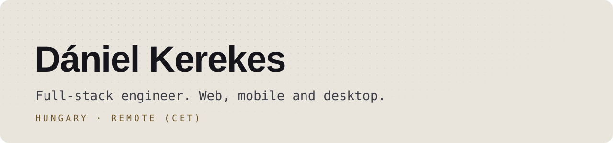

<picture>
  <source media="(prefers-color-scheme: dark)" srcset="assets/banner-dark.svg">
  
</picture>

### Hi, I'm Dániel.

Full-stack engineer from Hungary, working with React, TypeScript, React Native and Node.js. Most of what I build is client work I can't show here. These are the things I can.

I'm a big fan of open source. I've learned a lot from reading other people's code, so most of my own tools end up public too. Issues and pull requests are always welcome.

#### Products

<table>
  <tr>
    <td width="50%" valign="top">
      <a href="https://vectis.kerd.dev"><b>Vectis</b></a> 
      GitHub Actions jobs in throwaway macOS, Ubuntu and Windows VMs on your own Apple silicon Mac. 
      <a href="https://vectis.kerd.dev">Website</a> · <a href="https://github.com/kerddotdev/vectis">Source</a>
    </td>
    <td width="50%" valign="top">
      <a href="https://www.gradmate.hu"><b>GradMate</b></a> 
      A study platform for university students, with an AI study partner that only works from your own notes. 
      <a href="https://www.gradmate.hu">Website</a>
    </td>
  </tr>
  <tr>
    <td width="50%" valign="top">
      <a href="https://github.com/kerddotdev/upster"><b>Upster</b></a> 
      Put small apps from your computer online on your own domain, without renting a server. 
      <a href="https://github.com/kerddotdev/upster">Source</a> · <code>brew install kerddotdev/tap/upster</code>
    </td>
    <td width="50%" valign="top">
      <a href="https://inbot.kerd.dev"><b>Inbot</b></a> 
      Email inboxes for AI agents, stored encrypted on your own machine. Nothing goes out until you approve it. 
      <a href="https://inbot.kerd.dev">Website</a> · <a href="https://github.com/kerddotdev/inbot">Source</a>
    </td>
  </tr>
</table>

#### Developer tools

- [**wd**](https://github.com/kerddotdev/wd) - jump into any project and open its whole workspace with one command
- [**claude-debug-mode**](https://github.com/kerdofficial/claude-debug-mode) - hypothesis-driven debugging for Claude Code
- [**CodeTrack**](https://github.com/kerdofficial/CodeTrack) - your editor time as a contribution grid in the menu bar
- [**Tokenizer**](https://github.com/kerdofficial/Tokenizer) - live token counts for OpenAI models, as a native Mac app

#### Everything else

- [**homebridge-philips-airplus**](https://github.com/kerdofficial/homebridge-philips-airplus) - Philips Air+ humidifiers in Apple Home

<a href="https://kerd.dev">kerd.dev</a> · <a href="https://www.linkedin.com/in/d%C3%A1niel-kerekes-526838442">LinkedIn</a>

